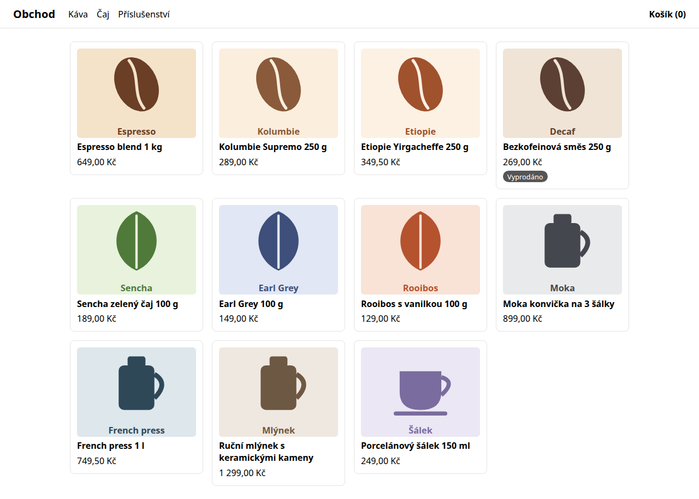
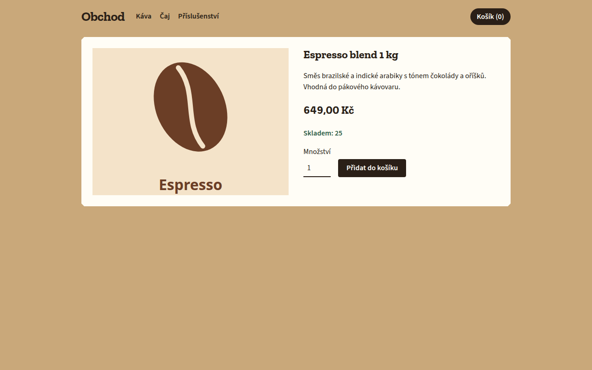
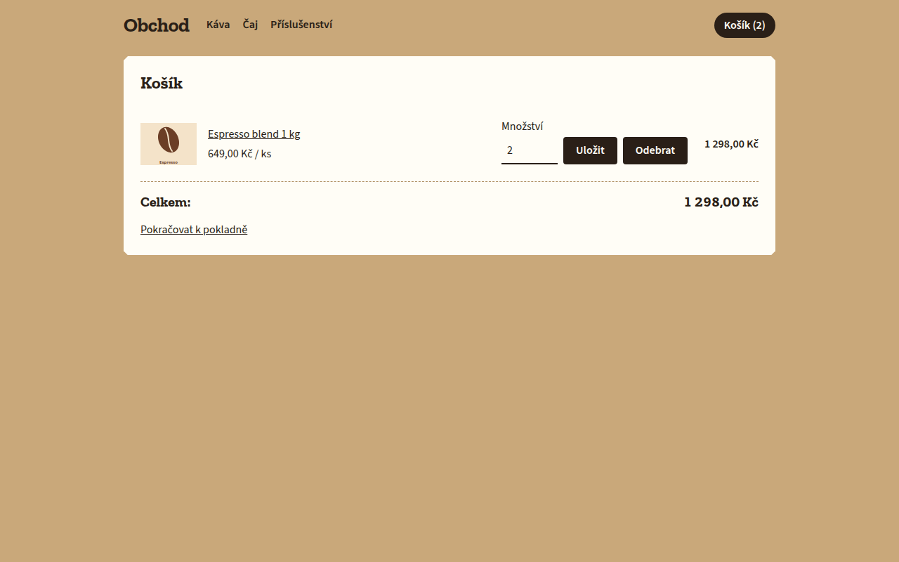
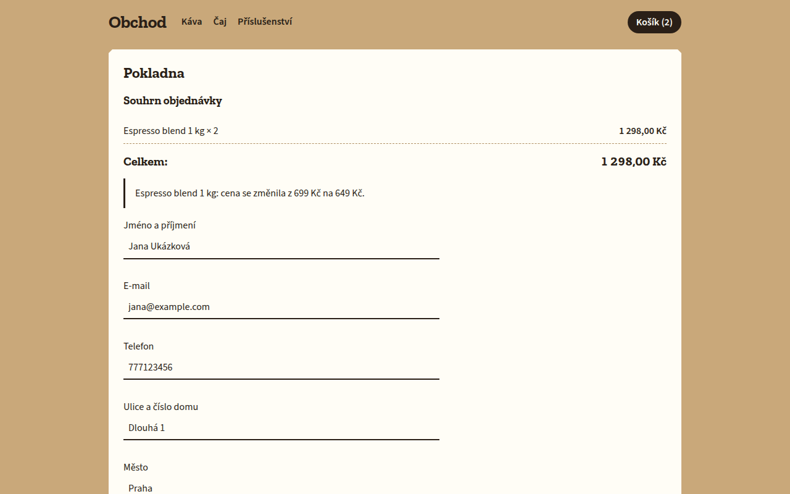
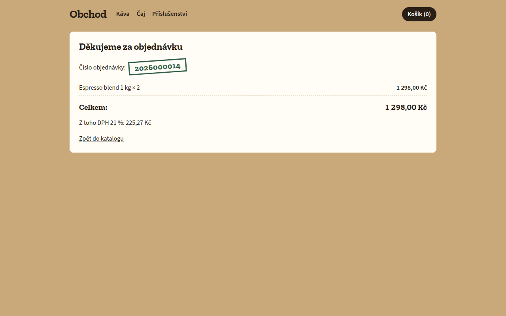

# Shop React

A React + TypeScript storefront for the coffee & tea shop from
**[laravel-shop](https://github.com/jantydlacka/laravel-shop)**. It is the same
shop with a second frontend: the catalogue, the stock, the prices, the quantity cap and the order
limit all live in laravel-shop and are reached over its JSON API (`/api`). This client holds the
cart, validates what comes back and places the order. It is a portfolio project, deliberately
small; the storefront is in Czech, code, comments and docs are in English.

**[Try the demo](https://jantydlacka.github.io/shop-react/)** – it runs without a server: the
responses of the API are simulated in the browser by MSW, with the catalogue of the
[laravel-shop](https://github.com/jantydlacka/laravel-shop) demo data.
A panel at the top arms an edge case; each one fires once, at the next cart check or order (price change, sold out, network
failure, an already ordered cart, a validation error, the order limit). The real API is in
laravel-shop; the screenshots below come from it.

| Catalogue | Product |
|---|---|
|  |  |

| Cart | Checkout after a price change | Confirmation |
|---|---|---|
|  |  |  |

The screenshots come from a throwaway Playwright script driving Chrome against the running API and
the demo data of laravel-shop. The price notice in the checkout screenshot is the server's real 409
answer; to get it, the script put a cart with an older price into `localStorage` before submitting.

## Stack

React 19 · TypeScript · Vite · React Router · TanStack Query · React Hook Form · zod ·
Vitest + Testing Library + MSW

## Running it

The client needs the API, so start [laravel-shop](https://github.com/jantydlacka/laravel-shop) first
and follow the quick start in its README (Docker and Sail; `./vendor/bin/sail up -d --wait`, then migrate and seed). The shop then listens on
<http://localhost:8088>, and confirmation e-mails land in Mailpit once the queue is processed
(`./vendor/bin/sail artisan queue:work`).

Then, in this repository (Node version from `.nvmrc`):

```bash
nvm use && npm ci && npm run dev
```

The dev server proxies `/api` to `http://localhost:8088`. If the API runs elsewhere, set
`VITE_API_PROXY` (for example `VITE_API_PROXY=http://localhost:8000 npm run dev`). Sail publishes
port 5173 as well; when it is taken, Vite picks the next free port and prints it.

The demo build is `npm run build:demo` (output in `dist-demo/`, base path `/shop-react/`);
`npm run preview:demo` serves it locally. The normal build never contains the demo: `npm run check`
ends with `scripts/check-no-demo.sh`, which fails when `dist/` holds the mock worker, the banner or the panel.

### Publishing the demo

`.github/workflows/pages.yml` deploys the demo to GitHub Pages on every push to `main`, after the
checks pass. Enable Pages first (Settings → Pages → Source: GitHub Actions) and merge to `main`
only afterwards – without it the deploy job fails.

## Tests and quality

`npm run check` is the single gate. CI (`.github/workflows/ci.yml`) runs it on pushes to main and
on pull requests. It runs, in order:

1. `tsc -p tsconfig.app.json --noEmit` and `tsc -p tsconfig.node.json --noEmit` – type check
2. `eslint .`
3. `vitest run` – component and unit tests with the API mocked by MSW
4. `vite build`
5. `scripts/check-no-demo.sh` – fails when `dist/` contains the demo

## Architecture decisions

**The cart lives in the client, the API is stateless.** The cart is kept in `localStorage`; the
server only compares it with current prices and stock (`POST /api/cart/check`) and turns it into an
order (`POST /api/orders`). There is no server session, no cookie and no login.

**The cart token is the idempotency key.** The client generates a UUID with the cart and sends it
with the order. A retry after a timeout or a double click therefore yields one order: the server
returns the existing order for the same token and the same items (HTTP 200 instead of 201). The same
token with different items is refused (409 "already ordered"), and the client then renews the token.
Because a 200 returns the order as it was first placed, the confirmation then says so and asks the
customer to check the details in the confirmation e-mail – data edited before the retry are not applied.
The token is renewed after an order is placed, so the next purchase is a new one.

**A stale cart is corrected, not rejected silently.** If a price, availability or stock changed, the
server answers 409 with the current values; the client replaces the cart lines, shows what changed
and lets the customer submit again.

**zod validates at the API boundary.** Every response is parsed before it reaches the UI, and the
wire format (snake_case) is mapped to client types in one place. Generating the types from OpenAPI
(Scramble) was tried and produced wrong types for this API – for example messages typed as string,
`product_id` as string and `image_url` as null – so the client validates responses with zod instead.

**The form rules mirror the server for UX only.** The checkout schema repeats the server's
`CheckoutRules` so most mistakes are caught before a request is sent. The two can still differ at
the edges: the client counts maximum lengths in UTF-16 units and the server in characters, so text
full of emoji close to a limit may be judged differently. The server's 422 is authoritative and is
shown field by field.

**Prices are integer hellers** end to end; only the client formats them (`Intl.NumberFormat('cs-CZ')`).

Fonts: Zilla Slab and Source Sans 3 (`src/assets/fonts`, latin and latin-ext subsets), licensed under the SIL Open Font License 1.1, see `src/assets/fonts/OFL-ZillaSlab.txt` and `src/assets/fonts/OFL-SourceSans3.txt`.

## Known limitations

- **Two tabs share `localStorage` but not in-memory state**, so the last write wins and the other
  tab shows a stale cart until it is reloaded. Orders stay correct, because the token is tied to the
  contents of the cart and the server checks prices and stock again.
- **The order confirmation survives a reload only in the same tab** (`sessionStorage`). There is no
  order lookup in the API by design – its responses carry no personal data – so a new tab shows
  "we no longer see the order" and points to the confirmation e-mail.
- **No end-to-end test suite.** The behaviour was walked through with a throwaway Playwright
  script driving Chrome against the running API (the screenshots come from those runs); nothing
  re-runs it automatically.
- **Server-side limitations apply**, see "Known limitations" in the laravel-shop README: the hourly
  order limit (10 per IP) is not atomic, so a burst of parallel requests can overshoot it, and
  behind a reverse proxy `trustProxies` must be configured, otherwise the limit applies to the
  whole shop.

### The demo

- **Bypass for network.** With the DevTools option "Bypass for network" the service worker is
  skipped, the mock does not answer and the catalogue stays empty.
- **No service worker, no demo.** When the browser blocks service workers, the page shows a notice
  and nothing else.
- **The mock is thin.** It does not reduce quantities to the stock and does not compute the
  server's limits (quantity cap, hourly order limit); it only reports an unknown or sold-out
  product, a changed price and the scenarios chosen in the panel.
- **Deep links answer HTTP 404.** GitHub Pages serves `404.html` (a copy of `index.html`) for paths
  it does not know, so a link such as `/shop-react/produkt/espresso-blend` shows the right page but
  with status 404.

## License

MIT, see [LICENSE](LICENSE).
